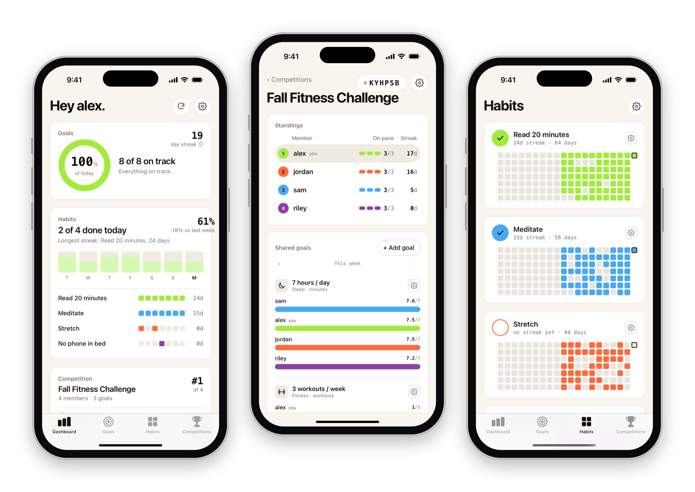
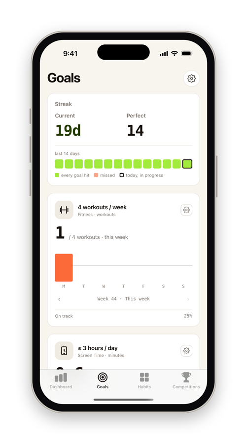
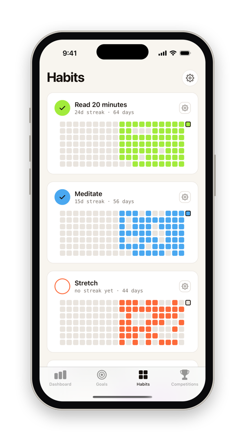
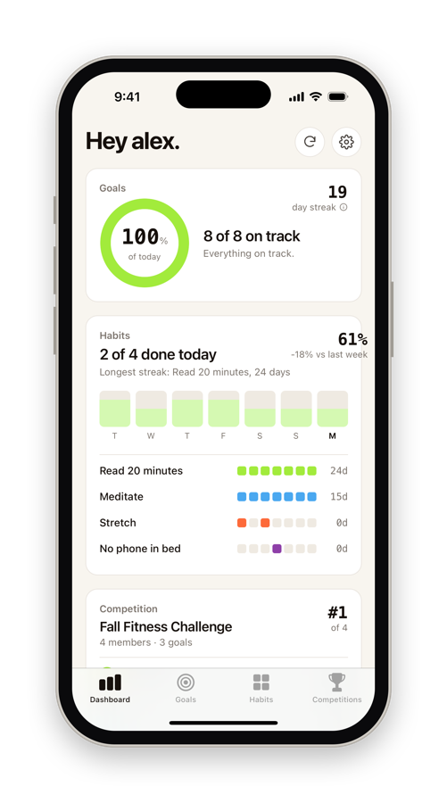
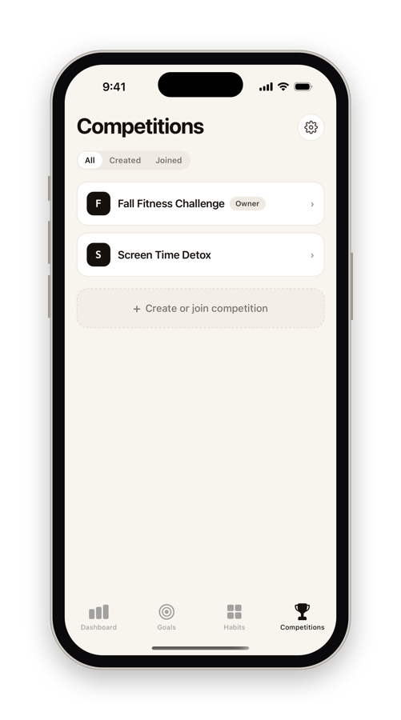
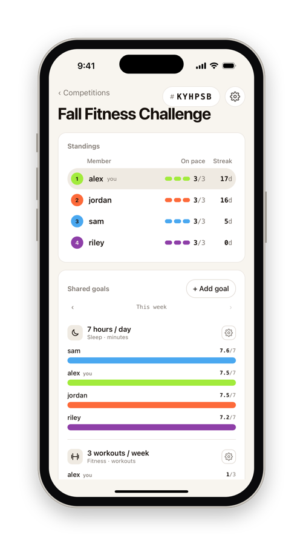

<h1 align="center">
  <picture>
    <source media="(prefers-color-scheme: dark)" srcset="docs/logo-dark.svg" />
    
  </picture>
</h1>

<strong>Goals get done when friends are watching.</strong>

Beacc tracks your goals automatically from the apps you already use, then puts you up against your friends.

  

---

## What you can do

### Set goals that track themselves

Pick something you want to do more of (or less of), set a target, and Beacc keeps score for you.

| Source | Goals you can set |
| --- | --- |
| **Steps** (Apple Health) | Walk 10,000 steps a day |
| **Sleep** (Apple Health) | Sleep 7 hours a night |
| **Workouts** (Apple Fitness) | Work out 4 times a week, or burn a set number of calories |
| **Screen Time** | Stay under 3 hours a day. |
| **GitHub** | Make 5 commits a week |
| **LeetCode** | Solve easy, medium or hard problems |

Goals can be **daily** (hit it every day) or **weekly** (hit it by Sunday). Each one shows this week's progress day by day, whether you're on pace, and lets you look back at earlier weeks. Give each goal its own color, and change its target whenever you like.

  

### Build habits

Not everything shows up in an app. Habits are the things you check off yourself, like reading, meditating or stretching. Tap to mark today done, and Beacc keeps a heatmap of every day you showed up, along with your current streak.

  

### Keep a streak

Every day you meet all your goals extends your streak.

  

### Compete with friends

Create a competition, share its code, and your friends join in seconds. The owner picks the shared goals, and everyone is measured against the same ones.

- **Standings** rank everyone by how many goals they're on pace for this week, with streak as the tie-breaker.
- **Shared goals** show each person's progress side by side, so you can see exactly who's ahead.
- **Your color** follows you through every competition. Pick it in Settings.
- **Look back** at any previous week to see how it ended.

The owner can rename the competition, change or remove goals, reset the join code, remove members or hand the competition to someone else.

  
  

